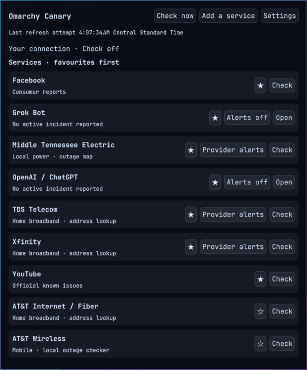
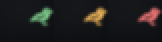

# Omarchy Canary


Click the canary icon to open the panel. The first open checks fifteen free official sources. Use **Check now** to refresh the feeds and run the local connection check if enabled and **Alerts off** beside any feed to opt in. The first successful check of each feed establishes a quiet baseline.

**Settings** has background checks, a local reachability check, quiet hours from 10 pm to 8 am, and a one-hour pause. Background checks and reachability start off. Background mode runs within the bar, checks every five minutes, and backs off on source errors. The local check tries HTTPS endpoints run by Google and Cloudflare and shows whether this PC can reach the internet. The main panel starts with favourites. Enable **Show all services on main panel** to show the full country directory below them. Open **Add a service** to search and star any service, including provider links. Choose the US, UK, Canada, Australia or Other / global to filter provider suggestions. Canary stores the country you choose locally and does not request your address or detect your location. Global feeds are available in every country. Some providers link to their own alert setup. Consumer reports links open in your browser. The plugin uses no tokens or accounts.

Most alert choices are whole provider feeds. Grok Bot is filtered to its labelled notices. AWS and Azure report public notices, and their rows do not assert service health or recovery. The other sources require an explicit resolution for a recovery notification. A missing incident stays in the last known state. Feed failures retain cached incidents, and the panel marks older data as unknown. The panel shows when each cached incident was last seen. A purple canary means current status is unavailable. A purple dot beside an amber or red canary means cached incidents also need confirmation. Only feeds selected for alerts affect the bar indicator.

Local data lives in `$XDG_STATE_HOME/omarchy-service-outages` or `~/.local/state/omarchy-service-outages`. The only desktop dependencies beyond Omarchy are Python 3 and `notify-send`.

## Install on Omarchy

```sh
omarchy plugin add https://github.com/shaggyrs6-netizen/omarchy-canary --enable
```

Click the canary in the bar. Choose **Add a service** to pick a country and star your providers. Enable **Background checks** in Settings if you want Canary to check while the panel is closed. For desktop notifications, switch on alerts beside the official feeds you want to follow.

To disable the widget, run `omarchy plugin disable shaggyrs6.service-outages`.

## Screenshots





The bar colours are shown using Canary's dummy preview.

## Licence

[MIT](LICENSE)
