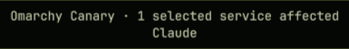
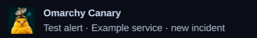
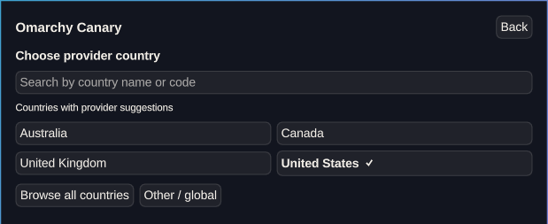
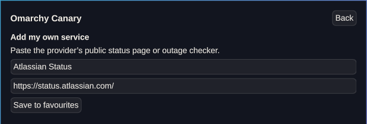
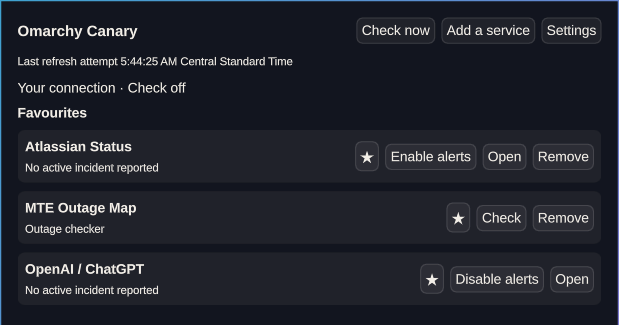
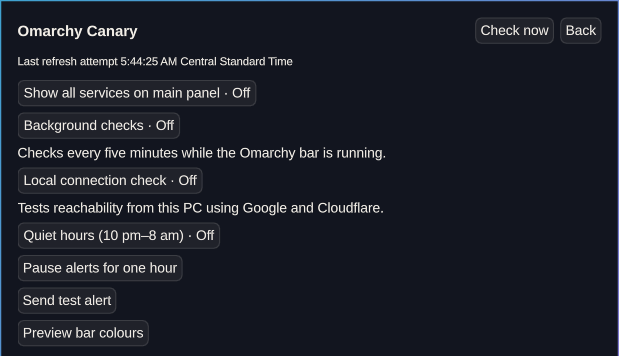

# Omarchy Canary


Click the canary icon to open the panel. The first open checks fifteen free official sources. Use **Check now** to refresh the feeds and run the local connection check if enabled. Select **Enable alerts** beside a feed to opt in. The first successful check of each feed establishes a quiet baseline.

**Settings** has background checks, a local reachability check, quiet hours from 10 pm to 8 am, and a one-hour pause. Background checks and reachability start off. Background mode runs within the bar, checks every five minutes, and backs off on source errors. The local check tries HTTPS endpoints run by Google and Cloudflare and shows whether this PC can reach the internet. The main panel starts with favourites. Enable **Show all services on main panel** to show the country directory below them.

Choose **Send test alert** in Settings to see a sample desktop notification. You can send it with no alert subscriptions and while Canary alerts are paused.

## Find and add services

Open **Add a service**, then select the country button and search by country name or code. Local provider suggestions are included for the US, UK, Canada and Australia. Global feeds and custom favourites are available for every country. Canary stores your selection on this device. Some providers link to their own alert setup. Consumer reports open in your browser.

If your provider is missing, choose **Add my own service**, enter a name, and paste the provider’s public status page or outage checker. Canary checks compatible HTTPS Atlassian Statuspage URLs for a public incident history. Paste the status page’s main URL or its public API URL. When the feed validates, **Enable alerts** turns on Canary notifications using the first check as a quiet baseline. Enable **Background checks** for alerts while the panel is closed. If Canary cannot read a supported feed, the service is saved as a favourite with a browser shortcut. To retry feed detection later, add the same address again. Custom services and alert preferences are stored locally.

To delete a custom service, choose **Remove** on its row and confirm. This also clears its Canary alert choice and saved incident history. Use the star to unpin a service and keep it in the directory.

Most alert choices are whole provider feeds. Grok Bot is filtered to its labelled notices. AWS and Azure report public notices, and their rows do not assert service health or recovery. The other sources require an explicit resolution for a recovery notification. A missing incident stays in the last known state. Feed failures retain cached incidents, and the panel marks older data as unknown. The panel shows when each cached incident was last seen. A purple canary means current status is unavailable. A purple dot beside an amber or red canary means cached incidents also need confirmation. Only feeds selected for alerts affect the bar indicator. Hover over the bird to see the names of services with current incidents.

Local data lives in `$XDG_STATE_HOME/omarchy-service-outages` or `~/.local/state/omarchy-service-outages`. The only desktop dependencies beyond Omarchy are Python 3 and `notify-send`.

## Install on Omarchy

```sh
omarchy plugin add https://github.com/shaggyrs6-netizen/omarchy-canary --enable
```

Click the canary in the bar. Choose **Add a service** to pick a country and star your providers. Enable **Background checks** in Settings if you want Canary to check while the panel is closed. For desktop notifications, switch on alerts beside the official feeds you want to follow.

For an existing Git-managed installation, run `omarchy plugin update shaggyrs6.service-outages`. If the open panel still shows the previous controls after updating, run `omarchy restart shell`. Existing favourites and settings carry over.

To disable the widget, run `omarchy plugin disable shaggyrs6.service-outages`.

## Screenshots





| Country picker | Add a custom service |
| --- | --- |
|  |  |

| Favourites and alert controls | Test alert in Settings |
| --- | --- |
|  |  |


## Licence

[MIT](LICENSE)


## Running tests

Run `python3 -B -m unittest discover -s tests`. Fixtures cover incident parsing,
alert transitions, cached status, slow and failed feeds, and state writes without
contacting public feeds. Failed public checks appear in the Omarchy shell log
with the feed ID and error type. The log does not include response bodies.
